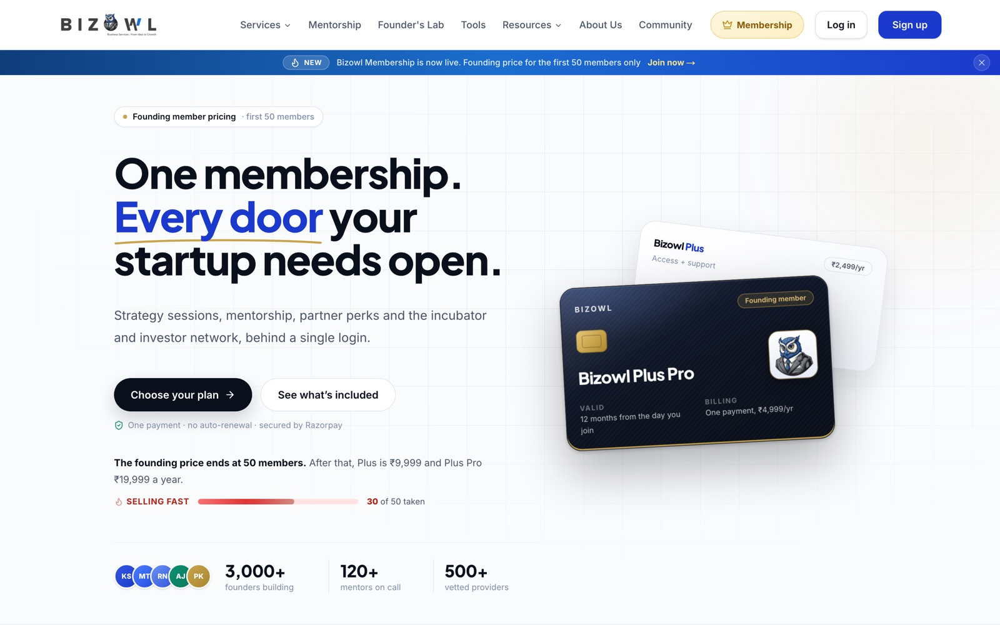
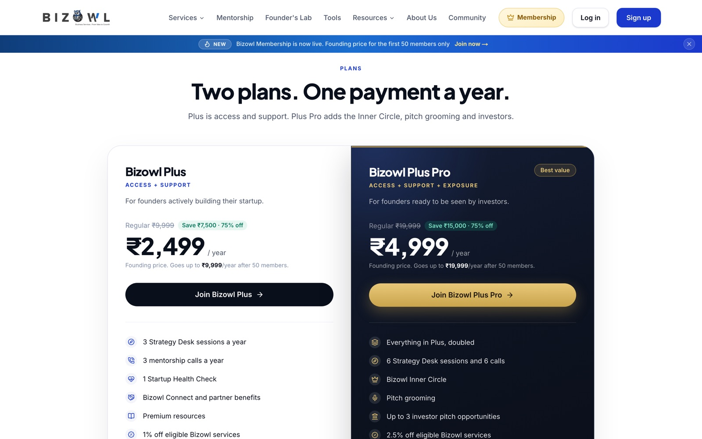
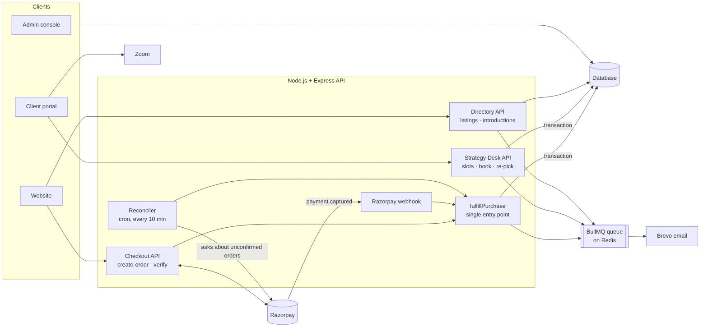
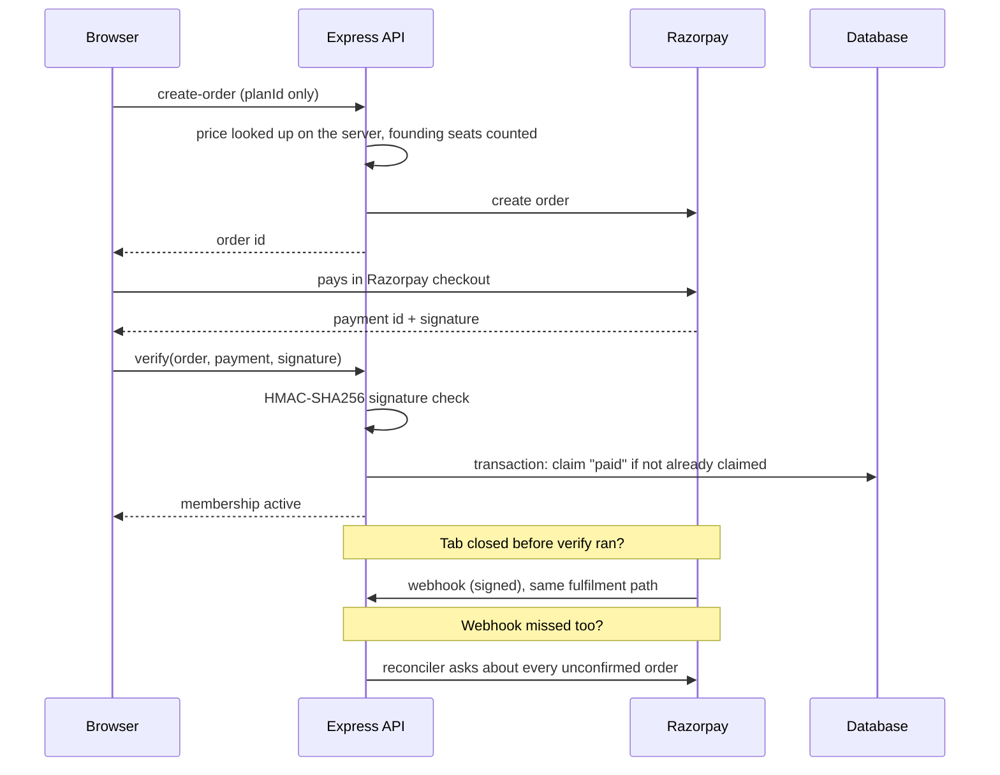
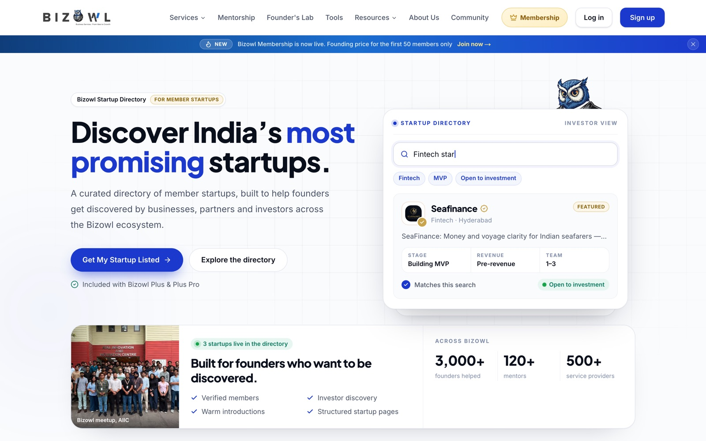
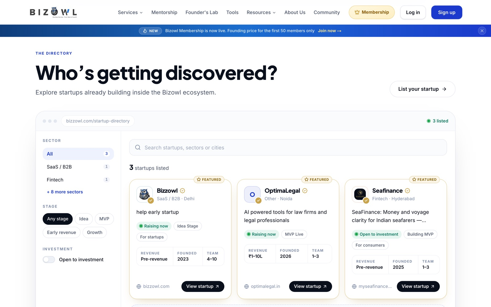
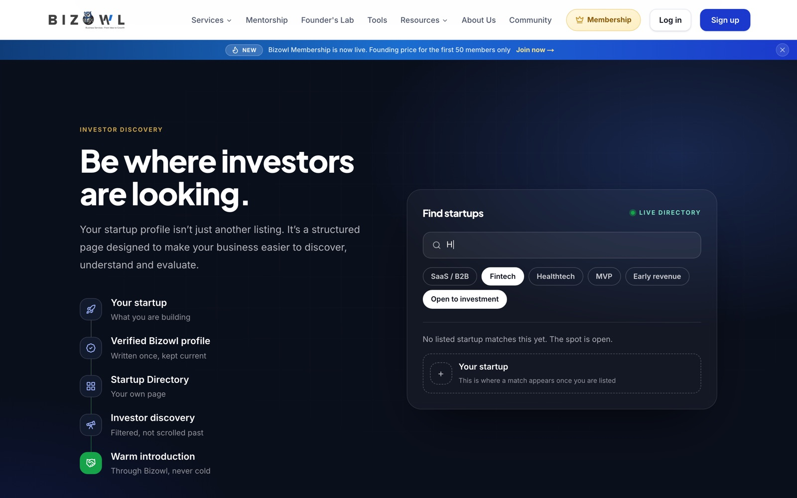

# Bizowl Founder Membership & Startup Directory: Case Study

A paid membership and an investor-facing startup directory, built and launched in production at **[Bizowl](https://www.bizzowl.com)** (White Sense Pvt. Ltd.), a startup platform with 1,000+ users.

| | |
|---|---|
| **What** | Bizowl's first paid product: two membership tiers, member benefits, session booking, and a Startup Directory that puts member startups in front of investors |
| **My role** | Full Stack Developer Intern. I designed and built the payment flow, the benefits backend, the member portal, the Startup Directory and the admin console, then migrated all of it to a new stack |
| **Outcome** | **10+ founders bought on launch day.** Payments activate automatically, with no manual reconciliation |
| **Stack** | React · Node.js · Express · Firestore → **Next.js 16 · TypeScript · Express 5 · MongoDB · Clerk** · Razorpay · BullMQ · Redis · Zoom |
| **Live** | [Membership](https://www.bizzowl.com/founder-membership) · [Startup Directory](https://www.bizzowl.com/startup-directory) |

> The production code is private and belongs to Bizowl. This repository explains how the system works and why it was built this way. The code in [`examples/`](examples) is written for this case study to illustrate the patterns. It is not copied from the product.

**Contents:** [The problem](#the-problem) · [Architecture](#architecture) · [Payments](#how-a-payment-becomes-a-membership) · [Engineering decisions](#key-engineering-decisions) · [Startup Directory](#startup-directory) · [Migration to Next.js](#migrating-to-nextjs-typescript-and-mongodb) · [Testing](#testing)

---

## The problem

Bizowl had 1,000+ users across its website, client portal and mentor platform, but no recurring paid product. The founder wanted a membership that:

- sells in **two tiers** (Plus and Plus Pro) at a lower **founding price** for the **first 50 members**, then switches to the regular price automatically
- unlocks member benefits the moment a payment succeeds, with no manual step
- lets members **book sessions with the Bizowl team** from a calendar, without two people taking the same slot
- gets member startups **discovered by investors**, the benefit that sells the higher tier
- gives the team an **admin console** to run all of it

The hard part was not the UI. It was making money and access correct when browsers close, networks drop and webhooks arrive late or twice.

---

## Architecture

---

## How a payment becomes a membership

---

## Key engineering decisions

### 1. Three ways to confirm a payment, one way to fulfil it

A buyer can pay and close the tab one second later. A webhook can be delayed, retried or not configured. So a captured payment is confirmed by whichever of these gets there first:

| Path | When it helps |
|---|---|
| **`/verify`** from the buyer's tab | The normal case: instant activation |
| **Razorpay webhook** | The tab closed before `/verify` ran |
| **Reconciler** (cron, every 10 minutes) | Both of the above missed it. It asks Razorpay about every order from the last 30 days that isn't marked paid |

All three call the same `fulfillPurchase` function. It claims the `paid` flag inside a **database transaction**, and only the path that wins the claim sends the welcome email and writes the payment record. **No payment goes unrecorded, and nobody gets activated or emailed twice.**

See [`examples/idempotent-fulfilment.js`](examples/idempotent-fulfilment.js).

### 2. The server decides the price, never the browser

The browser sends only a `planId`. The server looks up the price, counts the founding seats left and creates the Razorpay order. If the price the buyer saw no longer matches (for example, the last founding seat was just taken), the order is **refused with an explanation** instead of charging a different amount silently.

### 3. Founding seats counted from real purchases

The "seats left" number comes from founding-price purchases that were actually paid, not from a counter that can drift. The page can't show fewer seats than really remain. The count is cached for 30 seconds, so a busy launch doesn't hammer the database.

### 4. Signed webhooks, checked in constant time

The webhook signature is an HMAC-SHA256 over the **raw request bytes**. A re-serialised JSON body can produce a different signature, so the raw bytes are used. Signatures are compared with `crypto.timingSafeEqual` after a length check. If the webhook secret is missing, the endpoint returns an error, so Razorpay **retries instead of dropping the event**.

I also found that the Razorpay **secret key was being sent to the browser** and moved it to the server.

### 5. Race-free session booking

Members book 30-minute **Strategy Desk** sessions with the Bizowl team: Monday to Saturday, 11:30 to 18:00 IST, with a 10-minute buffer. That makes 10 slots a day. Two founders clicking the same slot at the same moment must not both get it.

Each booking runs in **one transaction** that reads two lock documents, **one per member and one per time slot**, before writing. The database retries a transaction when anything it read has changed, so the second booking sees the slot taken and is rejected cleanly. The request id is the ticket id, so **a retried request can't create a duplicate booking**. The transaction also enforces each plan's yearly allowance (3 sessions on Plus, 6 on Plus Pro).

See [`examples/slot-booking.js`](examples/slot-booking.js).

### 6. Emails off the request path

The welcome email, booking confirmations and calendar invites (`.ics`) go through a **BullMQ queue on Redis** to Brevo. A slow email provider never slows down checkout, and failed sends are retried.

While building this, I traced a **silent failure**: booking confirmation emails and mentor WhatsApp alerts had stopped months earlier because the code imported the email queue from the wrong module. Nothing logged an error. I fixed the import and added tests.

---

## Startup Directory

A public, investor-facing directory of member startups. It's the main reason founders choose the higher tier.

### Who gets listed is decided in one place

A startup is listed only when **both** are true:

1. It holds a live **Plus or Plus Pro** membership.
2. Its startup profile is at least **80% complete**.

Both rules are checked **on the server, in one module**, rather than wherever a listing is shown. The directory, the client portal and the admin panel can never disagree about whether someone is live. **Plus Pro listings rank above Plus**, and the weekly spotlight is drawn from them. That's what "priority placement" means in code.

### A profile built around what investors ask

I rebuilt the startup profile so that **every question answers something an investor needs**: the problem, solution, customer, what's different, revenue model, traction, funding and team. Questions about the round only count toward completeness while the startup is raising.

### Private by default

The public listing is a **projection**: it returns only fields the founder filled in on their profile. Contact details such as phone and work email are never read by the directory code at all. Revenue is shown as a **band** ("Pre-revenue", "₹1–10L" and so on up to "₹2Cr+"), and team size as a range, never exact figures.

### Investor search and filters

Investors search by name, sector or city, and filter by **sector, stage and "open to investment"**. Each active filter shows as a chip that can be removed. Sectors that have startups are listed first. Every startup gets its **own public page** (`/startup-directory/<slug>`), listed in the sitemap so search engines can find it.

### Warm introductions without exposing the founder

"Request an introduction" emails the founder directly, with **reply-to set to the sender**. The founder replies in one click, and their own address stays private until they choose to answer. The Bizowl team gets a copy, and every request is stored with its delivery status. Spam is prevented at three levels:

- **10 requests an hour** per IP address
- **one message a day** per sender per startup
- **at most 10 introductions a day** reaching any one founder

---

## Migrating to Next.js, TypeScript and MongoDB

After launch, Bizowl moved its platform to a new stack. I ported the **membership, Startup Directory, startup profile and mentorship** features from the original React + Firestore apps to **Next.js 16, TypeScript, Express 5, MongoDB (Mongoose) and Clerk** authentication. The backend uses a controller → service → model structure. **This is the version running on bizzowl.com today.**

- **Data migration tooling.** I wrote scripts that export the old Firestore data read-only and import it into MongoDB. They run as a **dry run by default** and only write with an explicit `--apply` flag, and I rehearsed them on throwaway databases first. Imported members get a placeholder account that is matched to their real login the first time they sign in with the same email, so nobody has to re-register.
- **Fixed legacy gaps on the way.** In the old mentorship flow, the session price came from the browser, and the scheduling and review endpoints had no authentication. In the new version the server sets the price, and those endpoints require sign-in.

---

## What members get

- Strategy Desk sessions with the Bizowl team, booked from a calendar
- Mentor sessions, a startup health check, investor pitch review and a social showcase
- A listing in the **Startup Directory**
- A members area in the client portal that shows each benefit and its status

## Admin console

The team runs memberships from the admin panel. They can see every member, their plan year and email status, handle requests, see the slot a member booked, and follow up on checkouts that weren't finished.

---

## Testing

Backend routes are tested with **Jest and Supertest** against an in-memory database mock, using fake timers for slot and date logic. The tests cover:

- double booking
- yearly allowances
- re-picking a slot
- retried requests
- weekday and hour boundaries

## Tech stack

| | Version 1 | Version 2 (live) |
|---|---|---|
| **Frontend** | React · Chakra UI | Next.js 16 · TypeScript |
| **Backend** | Node.js · Express | Express 5 · TypeScript |
| **Data** | Firebase Firestore | MongoDB · Mongoose |
| **Auth** | Firebase Auth | Clerk |
| **Payments** | Razorpay (orders, signature verification, webhooks) | Razorpay |
| **Jobs and email** | BullMQ · Redis · Brevo · node-cron | Redis · Brevo (background workers) |
| **Calls** | Zoom | Zoom |
| **Testing** | Jest · Supertest | |

---

*Case study by Anurag Kumar. Product code remains private to Bizowl.*
