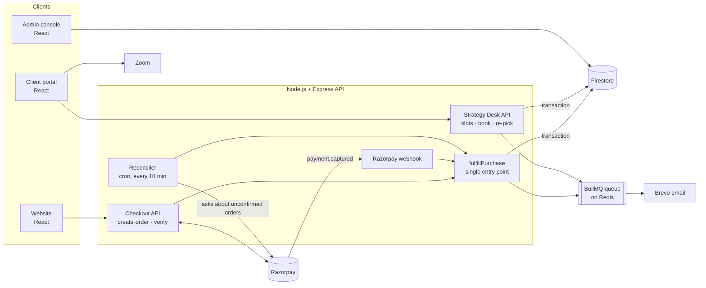

# Bizowl Founder Membership: Case Study

A paid annual membership for startup founders, built and launched in production at **[Bizowl](https://www.bizzowl.com)** (White Sense Pvt. Ltd.). It sold to **10+ founders on launch day**.

**Live:** https://www.bizzowl.com/founder-membership
**Role:** Full Stack Developer Intern. I designed and built the payment flow, the member benefits backend, the member portal and the admin console.
**Built:** September 2026

> The production code is private and belongs to Bizowl. This repository explains how the system works and why it was built this way. The code in [`examples/`](examples) is written for this case study to illustrate the patterns. It is not copied from the product.

---

## The problem

Bizowl already had 1,000+ users across its website, client portal and mentor platform, but no recurring paid product. The founder wanted a membership that:

- sells in **two tiers** (Plus and Plus Pro) at a lower **founding price** for the **first 50 members**, then switches to the regular price automatically
- unlocks member benefits the moment a payment succeeds, with no manual step
- lets members **book sessions with the Bizowl team** from a calendar, without two people taking the same slot
- gives the team an **admin console** to run memberships and follow up with members

The hard part was not the UI. It was making money and access correct when browsers close, networks drop and webhooks arrive late or twice.

---

## Architecture

---

## How a payment becomes a membership

---

## Key engineering decisions

### 1. Three ways to confirm a payment, one way to fulfil it

A buyer can pay and close the tab one second later. A webhook can be delayed, retried or not configured. So a captured payment is confirmed by whichever of these gets there first:

| Path | When it helps |
|---|---|
| **`/verify`** from the buyer's tab | The normal case: instant activation |
| **Razorpay webhook** | The tab closed before `/verify` ran |
| **Reconciler** (cron, every 10 minutes) | Both of the above missed it. It asks Razorpay about every order from the last 30 days that isn't marked paid |

All three call the same `fulfillPurchase` function. It claims the `paid` flag inside a **Firestore transaction**, and only the path that wins the claim sends the welcome email and writes the payment record. **No payment goes unrecorded, and nobody gets activated or emailed twice.**

See [`examples/idempotent-fulfilment.js`](examples/idempotent-fulfilment.js).

### 2. The server decides the price, never the browser

The browser sends only a `planId`. The server looks up the price, counts the founding seats left and creates the Razorpay order. If the price the buyer saw no longer matches (for example, the last founding seat was just taken), the order is **refused with an explanation** instead of charging a different amount silently.

### 3. Founding seats counted from real purchases

The "seats left" number comes from founding-price purchases that were actually paid, not from a counter that can drift. The page can't show fewer seats than really remain. The count is cached for 30 seconds, so a busy launch doesn't hammer the database.

### 4. Signed webhooks, checked in constant time

The webhook signature is an HMAC-SHA256 over the **raw request bytes**. A re-serialised JSON body can produce a different signature, so the raw bytes are used. Signatures are compared with `crypto.timingSafeEqual` after a length check. If the webhook secret is missing, the endpoint returns an error, so Razorpay **retries instead of dropping the event**.

I also found that the Razorpay **secret key was being sent to the browser** and moved it to the server.

### 5. Race-free session booking

Members book 30-minute **Strategy Desk** sessions with the Bizowl team: Monday to Saturday, 11:30 to 18:00 IST, with a 10-minute buffer. That makes 10 slots a day. Two founders clicking the same slot at the same moment must not both get it.

Each booking runs in **one Firestore transaction** that reads two lock documents, **one per member and one per time slot**, before writing. Firestore retries a transaction when anything it read has changed, so the second booking sees the slot taken and is rejected cleanly. The request id is the ticket id, so **a retried request can't create a duplicate booking**. The transaction also enforces each plan's yearly allowance (3 sessions on Plus, 6 on Plus Pro).

See [`examples/slot-booking.js`](examples/slot-booking.js).

### 6. Emails off the request path

The welcome email, booking confirmations and calendar invites (`.ics`) go through a **BullMQ queue on Redis** to Brevo. A slow email provider never slows down checkout, and failed sends are retried.

While building this, I traced a **silent failure**: booking confirmation emails and mentor WhatsApp alerts had stopped months earlier because the code imported the email queue from the wrong module. Nothing logged an error. I fixed the import and added tests.

---

## What members get

- Strategy Desk sessions with the Bizowl team, booked from a calendar
- Mentor sessions, a startup health check, investor pitch review and a social showcase
- A listing in the Bizowl **Startup Directory**
- A members area in the client portal that shows each benefit and its status

## Admin console

The team runs memberships from the admin panel. They can see every member, their plan year and email status, handle requests, see the slot a member booked, and follow up on checkouts that weren't finished.

---

## Testing

Backend routes are tested with **Jest and Supertest** against an in-memory Firestore mock, using fake timers for slot and date logic. The tests cover:

- double booking
- yearly allowances
- re-picking a slot
- retried requests
- weekday and hour boundaries

## Tech stack

**Frontend:** React · Chakra UI
**Backend:** Node.js · Express
**Data:** Firebase Firestore (transactions) · Firebase Auth
**Payments:** Razorpay (orders, signature verification, webhooks)
**Jobs and email:** BullMQ · Redis · Brevo · node-cron
**Calls:** Zoom
**Testing:** Jest · Supertest
**Hosting:** Railway (API) · Firebase Hosting (portal)

## Outcome

- Launched in September 2026 to Bizowl's 1,000+ users
- **10+ founders bought a membership on launch day**
- Payments are activated automatically, with no manual reconciliation

---

*Case study by Anurag Kumar. Product code remains private to Bizowl.*
